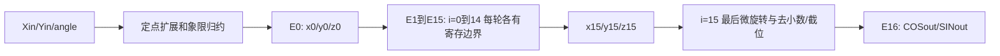

# CORDIC 实现与验证

## 1. 接口与实现选择

模块为 `cordic`，完整源码在 `src/cordic.v`。按原始位置例化严格保持以下端口顺序：

| 顺序 | 端口 | 方向 | 格式 |
|---|---|---|---|
| 1 | clk | input | 单比特，上升沿 |
| 2 | Xin | input | signed 16 位补码 |
| 3 | Yin | input | signed 16 位补码 |
| 4 | angle | input | unsigned 32 位 BAM 整圈编码 |
| 5 | COSout | output | signed 16 位，寄存器输出 |
| 6 | SINout | output | signed 16 位，寄存器输出 |
| 7 | done | output | 单比特，填满后连续有效 |

选择旋转模式、16 次迭代、每拍接收输入的全展开流水线。x/y 内部为 signed 32 位并带 12 位小数，残余角为 signed 33 位。没有增加复位、使能或握手端口。输出去小数使用算术右移，再取低 16 位回绕，不饱和。

这些流水线、定点格式及 done 的选择来自本次提示词约定；公开测试本身没有检查 done。它们不代表原作业额外规定了可靠启动握手。

## 2. 旋转公式与增益

角度 `theta=angle*2*pi/2^32`，0x40000000、0x80000000、0xc0000000 分别为 90、180、270 度。

```text
Ai = round(atan(2^-i) * 2^32 / (2*pi))
di = +1 (zi>=0), -1 (zi<0)
x(i+1) = xi - di*(yi >>> i)
y(i+1) = yi + di*(xi >>> i)
z(i+1) = zi - di*Ai
```

同一轮 x/y/z 都使用旧值。每个微旋转矩阵的模长增益为 sqrt(1+2^(-2i))，故：

```text
G16 = product(i=0..15, sqrt(1+2^(-2i))) = 1.6467602578654548
COSout ≈ G16*(Xin*cos(theta)-Yin*sin(theta))
SINout ≈ G16*(Xin*sin(theta)+Yin*cos(theta))
```

公开测试 Xin=19432、Yin=0，G16*19432=31999.845330841516，已接近目标幅度 32000；RTL 不再额外补偿增益。没有一般乘法、除法或实时三角函数。

## 3. 象限归约及提示词修正

| 原角度区间 | 初始向量 | 残余角 |
|---|---|---|
| [0°,90°) | 原向量 | angle |
| [90°,270°) | x/y 同时取负 | angle-2^31 |
| [270°,360°) | 原向量 | angle-2^32 |

残余角被归约到 [-90°,90°)。输入先符号扩展至 32 位并左移 12 位，然后才可能取负，因此 -32768 不会在 16 位域中取负溢出。

实现过程中纠正了提示词的一处位宽问题：signed 33 位范围为 [-2^32,2^32-1]，不能把 `33'sh100000000` 当作正的 2^32。在末象限分支，使用 `$signed({1'b1, angle})` 显式构造 angle-2^32 的 33 位补码。区间判断仍使用原 unsigned angle；这是选定分支后的符号构造，不依赖减去不可表示正数时的回绕。

半圈 2^31 可正常表示为正的 signed 33 位常量 `33'sh080000000`。主提示词已同步修正这一处说明。

## 4. 常量表、位宽与误差

角度表以 signed 33 位正数保存，下表列出低 32 位十六进制值；RTL 在前面补一个零十六进制位。

| i | Ai (hex) | i | Ai (hex) |
|---|---|---|---|
| 0 | 20000000 | 8 | 0028be53 |
| 1 | 12e4051e | 9 | 00145f2f |
| 2 | 09fb385b | 10 | 000a2f98 |
| 3 | 051111d4 | 11 | 000517cc |
| 4 | 028b0d43 | 12 | 00028be6 |
| 5 | 0145d7e1 | 13 | 000145f3 |
| 6 | 00a2f61e | 14 | 0000a2fa |
| 7 | 00517c55 | 15 | 0000517d |

全部 16 项已用独立 Python 数学计算逐项核对。独立 SV 自检也通过 $atan 实时计算自身参考常量，没有复制 DUT 的十六进制表。

| 信号 | 格式 | 核对 |
|---|---|---|
| Xin/Yin | signed 16 位整数 | -32768..32767 |
| 扩展输入、x/y 各级 | signed 32 位，12 位小数 | 先符号扩展，后左移/取负 |
| z/Ai | signed 33 位 BAM | 与向量定点比例独立 |
| 最终迭代及去小数结果 | signed 32 位 | >>>12，负值向负无穷取整 |
| 输出 | signed 16 位 | 显式取 [15:0]，模 2^16 |

输入最大模长保守取 sqrt(2)*32768；乘 G16 和 2^12 后约 312575733，显著小于 signed 32 位正上界 2147483647。逐次移位的少量量化误差不会接近该余量。每次旋转的 x/y 右移均在 signed 32 位域进行。

误差来源包括有限迭代残余角、BAM 常量量化、每轮移位量化、最终向下取整和输入端增益补偿的整数化。16 轮最后的旋转角约为 3.05e-5 rad；在约 32000 幅度下相应误差约为 1 个输出单位，另有最终小于 1 的去小数误差。这是量级分析，不替代测试或全输入误差证明。

实际公开测试相对其整数 golden 的最大绝对误差为 2。独立自检中不回绕样本对浮点旋转参考的最大误差，两路均为 1.800141，低于规定的 8。测试覆盖不构成全角度、全输入形式证明。

## 5. 寄存边界与时序



| 边沿 | 对输入组 A 的处理 |
|---|---|
| E0 | 接受输入并寄存归约后的 x0/y0/z0 |
| E1 | i=0，寄存 x1/y1/z1 |
| E2 | i=1，寄存 x2/y2/z2 |
| E3..E15 | i=2..14，各自推进一级 |
| E16 | i=15，直接寄存去小数后的两个输出 |
| E17 | 输出下一组 B，若 B 在 E1 输入 |

E0→E16 是 16 个完整周期、17 个采样边沿位置，吞吐率为每周期一组。不存在额外 x16/y16 后再寄存输出的 E17 延迟。

公开测试时钟周期为 4ns。初始输入 2ns 采样，66ns 首次输出；45 度输入在 1000ns 改变，1002ns 采样，1066ns 输出 [22626,22627]，1070ns 比较通过。后续角度每 1000ns 改变，输出均在改变后 66ns 更新。

done 是 17 位常数 1 移位链的末位，与第一个完整输出的边沿对齐。无复位、无初始化时启动值未定义；前 16 个边沿不保证数据或 done 有效，第 17 个边沿后 done 已知为 1，此后保持 1。它不是每个角度变化后脉冲一次的完成标志。硬件消费者仍需从系统层约定预热窗口。

## 6. 组合路径与物理时序限制

- 输入到第一级：定点扩展、常数左移、符号取反/选择和残余角归约。常数移位主要是布线。
- 级间：z 符号决定旋转方向；固定移位后的 x/y 加减，及 z 与常量加减。x/y 两路使用同级旧值并行计算，不串行更新。
- 最后一级：i=15 固定移位、方向选择与加减，之后 >>>12 和低 16 位选择，寄存输出。
- 输出寄存器到端口：没有额外算术；仍存在实际器件的 clk-to-Q、布线和输出负载。

generate 中各级移位次数为静态常量，查表函数也只在 elaboration 时按常量调用。RTL 使用 always_ff、非阻塞赋值和连续组合赋值，不含 initial、延迟、real、三角函数或多源驱动。

没有执行综合、门级仿真、STA、面积或功耗分析。缺少目标库与约束时，不能由 4ns 功能仿真宣称达到 250MHz，也不能确定最终关键路径是哪一级。

## 7. 实际验证与复现

按要求先执行：

```powershell
powershell -NoProfile -ExecutionPolicy Bypass -File .\run-local.ps1 -Task cordic
```

该原始入口退出码为 1，报 `cordic.f:1: ERROR: File name not terminated.`。原始 .f 最后一行缺少换行，Icarus 在解析列表时失败，尚未编译 RTL。错误保存在 `build/cordic/original_entry.log`；没有修改原列表、testbench 或原运行脚本。

使用新增入口显式列出源文件，分别运行同一原始公开 testbench 和独立自检：

```powershell
powershell -NoProfile -ExecutionPolicy Bypass -File .\run-cordic-checks.ps1
```

该入口实际使用 `iverilog -g2012 -Wall -DNO_FSDB` 和 `vvp`，两组编译、仿真均正常退出；编译无告警。最终 RTL 修正末象限符号构造后，已重新运行两组测试通过。

### 公开测试逐例结果

| 角度 | golden COS/SIN | 实际 COS/SIN | 最大绝对误差 |
|---|---|---|---|
| 45° | 22627,22627 | 22626,22627 | 1 |
| 15° | 30910,8282 | 30909,8282 | 1 |
| 30° | 27713,16000 | 27712,16000 | 1 |
| 60° | 16000,27713 | 16000,27712 | 1 |
| 75° | 8282,30910 | 8282,30909 | 1 |
| 90° | 0,32000 | 0,31999 | 1 |
| 180° | -32000,0 | -32000,0 | 0 |
| 270° | 0,-32000 | -1,-32000 | 1 |
| 359° | 31995,-558 | 31994,-560 | 2 |
| 57° | 17428,26837 | 17428,26837 | 0 |

```text
ALL PASS: CORDIC, 10 cases
```

### 独立自检

独立文件为 `verification/cordic_selfcheck_tb.sv`，不改动原测试。包含：

- 5 种向量分量 {-32768,-19432,0,19432,32767} 的 25 种组合，与 15 种边界角度交叉，共 375 组。角度覆盖 0、90、180、270 度边界及相邻 1 BAM 单位、整圈两端、45/315 度。
- 0..359 度逐度扫描 360 组，每拍改变角度。
- 32 组同一角度而不同 Xin/Yin，以及 4 组完全相同的重复输入。
- 固定种子生成 1000 组全位宽随机 Xin/Yin/angle，含非零 Yin。
- 两套参考：64 位逐轮整数模型逐位检查定点与回绕；独立浮点三角参考检查无回绕样本的误差。整数模型以 signed 角度区间归约，不复制 DUT 的 unsigned 分支结构。
- 每个采样边沿把参考结果放入固定延迟队列，独立决定何时应输出，不依赖 DUT done 决定预期。下降沿驱动，上升沿后 1ns 比较；使用四态比较拒绝 X/Z，预热后逐拍检查 done=1。

1790 个输入采样边沿中，前 16 个输出边沿被明确作为预热忽略，之后核对 1774 次输出。所有 1771 组主动驱动的测试样本均已流出，剩余检查为初始值和排空时的零向量；最终仍在流水线中的尾部数据均为排空零向量。

其中 862 次独立浮点误差检查通过；912 次为理想值明确超出 16 位范围的样本，按逐轮整数模型检查模 2^16 回绕，不把回绕造成的数值差计作普通三角误差。

```text
ALL PASS: CORDIC selfcheck checked=1774 numeric=862 wrapped=912 cycles=1790 max_error_x=1.800141 max_error_y=1.800141
```

四个坐标轴的实际输出：0°=[31999,-1]，90°=[0,31999]，180°=[-32000,0]，270°=[-1,-32000]，均在约定容差内。

## 8. 文件和波形

```text
src/cordic.v                              完整 RTL
verification/cordic_selfcheck_tb.sv        独立自检
verification/cordic_wave_dump.sv           公开测试波形辅助顶层
../../run-cordic-checks.ps1                根目录运行入口
```

工程根目录下的结果：

```text
build/cordic/public.compile.log
build/cordic/public.simulation.log
build/cordic/selfcheck.compile.log
build/cordic/selfcheck.simulation.log
build/cordic/cordic_public.vcd
build/cordic/original_entry.log
```

VCD 包含顶层输入输出和内部 x_q/y_q/z_q、warm_q 等信号；可在 Surfer 中展开 `cordic_tb.TEST_RUN`。先看 1000..1080ns，确认 1002ns 接收、1066ns 输出；数据端口设为 signed 十进制，angle 设为十六进制。每次运行新增入口会重新生成波形。

对实现前保存的 SHA256 基线核对，20 个受保护文件均未改动，包含原 CORDIC 测试与文件列表、Winograd、FSM 和现有运行脚本。除目标 RTL 与新增验证/说明文件外，本次只修正了 CORDIC 提示词中的正整圈常量说明。
