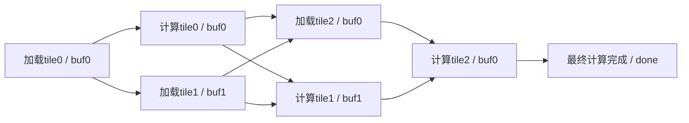
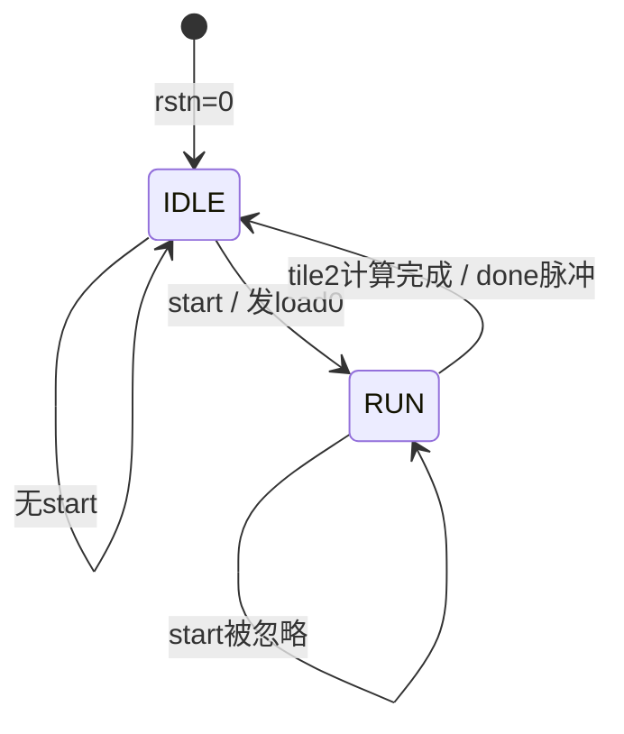
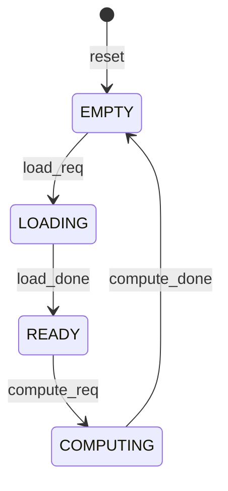

# 双缓冲 FSM 原理、实现与验证

## 1. 任务原理

加载引擎把数据搬入缓冲区，计算引擎消费缓冲区里的数据。每轮处理 tile0、tile1、tile2，固定映射为 buffer0、buffer1、buffer0。两个引擎各最多一个在途操作，延迟由真实完成脉冲决定，不在控制器中计固定周期。

核心调度是：先加载 tile0，然后加载 tile1 与计算 tile0 并行；tile0 计算完成后，buffer0 才可给 tile2 复用。加载 tile2 可与计算 tile1 并行；最后等待 tile2 的计算完成。这种乒乓方式用两个缓冲区隐藏加载/计算延迟。



箭头是资源或顺序依赖，不是固定周期。L1 与 C0、L2 与 C1 可并行。不能以 load_done 释放缓冲区，因为加载完成的数据还要等待并参与计算。

## 2. 接口

模块名及端口名称、顺序、方向、位宽保持原始接口。使用 SystemVerilog-2012，文件仍为 `src/double_buffer_ctrl.v`。

| 输入 | 位宽 | 意义 |
|---|---|---|
| clk | 1 | 单时钟，上升沿采样 |
| rstn | 1 | 低有效异步复位 |
| start | 1 | 空闲时接受新一轮任务 |
| load_done | 1 | 当前加载完成的单周期脉冲 |
| compute_done | 1 | 当前计算完成的单周期脉冲 |

| 输出 | 位宽 | 意义 |
|---|---|---|
| load_req | 1 | 请求加载，完整一周期脉冲 |
| load_tile | 2 | 有效请求的 tile 编号 |
| load_buf | 1 | 有效请求的 buffer 编号 |
| compute_req | 1 | 请求计算，完整一周期脉冲 |
| compute_tile | 2 | 有效请求的 tile 编号 |
| compute_buf | 1 | 有效请求的 buffer 编号 |
| busy | 1 | 本轮任务正在进行 |
| done | 1 | 三个 tile 计算全完成，单周期脉冲 |

请求和其元数据均为寄存输出。请求低时元数据保持；复位清零。busy 由寄存主状态译码。没有额外 ready 或事务 ID。

## 3. 主状态与缓冲状态



显式主状态为 IDLE/RUN。所有权、计数器和在途标志也是控制状态的一部分，并不是仅靠这两个名称区分所有阶段。

| 寄存信息 | 含义 |
|---|---|
| next_load_q、next_compute_q | 两位，0..2 为下个 tile，3 表示已全发出 |
| load_active_q、compute_active_q | 对应引擎已有一项在途操作 |
| full_q[1:0] | 各 buffer 已加载且未计算完成 |
| load_tile/load_buf | 加载请求元数据，在途时保持，可用于完成归属 |
| compute_tile/compute_buf | 计算请求元数据，在途时保持，可用于完成归属 |

每个 buffer 的概念状态由上述标志联合决定：



LOADING 由加载引擎在途标志预留，防止把 full=0 误当成空闲。READY/COMPUTING 期间 full 始终保持为 1，只有 compute_done 才清零。计算在途的同缓冲检查同时作为显式保护。

组合 next-state 先应用本轮完成事件，再调度加载，再调度计算。计算调度读取加载调度已经更新的预留信息，避免同拍冲突。两种完成若同拍出现，分别更新各自 buffer 位。请求寄存器默认清零，并检查上一周期请求，保证同一种请求之间至少有一个低周期。

## 4. 边沿、优先级及边界行为

- rstn 异步拉低最高优先，清零所有任务状态、输出和在途记录。任务中途复位会丢弃本轮，不产生 done。
- IDLE 对 start 按电平采样，接受边沿后发出 load0 且 busy=1。RUN 中的 start 忽略，不排队；start 持续为 1 时，返回空闲后的下一边沿可启动新一轮。
- 外部引擎在下一上升沿观察刚注册的请求。响应最早在请求接收的下一周期出现，不支持请求接收当拍响应。
- tile2 的 compute_done 在上升沿被采样后，同一边沿 NBA 更新出 done=1、busy=0；下一边沿 done 自动清零，若 start=1 可同时开始下一轮。
- 无对应在途操作的完成脉冲忽略。当前接口没有事务 ID，若复位后旧引擎响应恰好落在新操作在途期间，无法区分；环境需同步取消旧任务。
- 只有 next<3 才发请求并递增，终值 3 不作为 tile 输出，也不回绕为 0。

### 实际波形中的第一轮

时钟周期 10ns，公开测试第一轮 load 延迟 3 周期、compute 延迟 8 周期。下表取对应边沿 NBA 更新后的输出；引擎对新请求的接收晚一个上升沿。

| 时间 | 控制器动作 | 并行/资源意义 |
|---|---|---|
| 55ns | 接受 start，发 load0/buf0，busy=1 | 请求 65ns 被引擎接收 |
| 95ns | 消费 load0_done；发 load1/buf1 和 compute0/buf0 | 不同 buffer 并行 |
| 135ns | 消费 load1_done | buf1 READY，等待计算引擎 |
| 185ns | 消费 compute0_done；发 load2/buf0 和 compute1/buf1 | buf0 此时才可复用 |
| 225ns | 消费 load2_done | buf0 READY |
| 275ns | 消费 compute1_done；发 compute2/buf0 | 最后一项仍需等待完成 |
| 365ns | 消费 compute2_done，done=1，busy=0 | 全部完成 |
| 375ns | done=0 | 无新 start 时保持空闲 |

这解释了“完成后立即交接”的边沿含义：控制器可在采样完成的同一边沿后注册新请求，新请求由引擎在下一边沿接收。

## 5. 编码与时序范围

采用 always_comb 的完整默认赋值及带 default 的 case，always_ff 使用非阻塞赋值。各寄存器单一驱动，不含 latch、initial、延迟、门控时钟或运行时乘除。计数/比较使用两位常量，缓冲编号取计数最低位。

为避免 Icarus 对 always_comb 中常量选择的敏感列表提示，将计数最低位通过组合标量别名接入，保持 always_comb 风格及行为不变。

组合路径主要是：完成输入/当前寄存状态 → 资源可用性更新 → 两个调度条件 → 下一状态及请求寄存器。加载调度更新的预留信息会参与计算调度，形成一段控制逻辑依赖。busy 是状态寄存器到输出的译码路径。

本次只验证功能和周期协议。未执行综合、STA、面积/功耗或门级分析，10ns 功能时钟不能证明物理时序满足 100MHz。

## 6. 提示词与实际运行

完整提示词已先写入工程根目录 `prompts/fsm_prompt.md`，涵盖固定接口、状态与所有权、逐拍时序、复位/启动优先级、编码和工具反馈。

原始入口最终成功，退出码 0：

```powershell
powershell -NoProfile -ExecutionPolicy Bypass -File .\run-local.ps1 -Task fsm
```

输出：

```text
PASS: load latency=3 compute latency=8
PASS: reset during an active job
PASS: load latency=8 compute latency=3
ALL PASS
PASS: fsm
```

新增入口同时运行原始 testbench 和独立自检，并导出方便定位的公开波形：

```powershell
powershell -NoProfile -ExecutionPolicy Bypass -File .\run-fsm-checks.ps1
```

两组均以 `iverilog -g2012 -Wall` 编译，vvp 仿真正常退出，编译日志无告警。

## 7. 独立自检范围与结果

`verification/fsm_selfcheck_tb.sv` 使用事件驱动的两个独立引擎和 EMPTY/LOADING/READY/COMPUTING 所有权模型，只观察模块端口，不读取 DUT 内部状态。

覆盖：

- load 和 compute 延迟 1..5 的全部 25 种组合，含最短一周期及相等延迟。
- 20 轮固定种子随机测试，每个操作分别选择 1..9 周期延迟。
- 持续 start 的两轮紧邻任务，验证不在 RUN 内重启而在空闲后自动接受。
- 3 个在途复位场景：仅加载、加载与计算并行、最后一项正在计算。每次复位后重新运行一轮任务，验证恢复。
- 总计 50 轮完整任务与 3 轮故意中止任务。
- 忙碌 start 不排队；空闲时孤立的加载/计算完成脉冲不制造任务。
- 每轮 tile 顺序、每 tile 恰好一次请求、加载依赖、缓冲冲突、复用时机、真实重叠、脉冲宽度、元数据保持、busy、最后 done 的 NBA 边沿。
- 全部控制输出拒绝 X/Z，设置逐轮和全局超时。请求在上升沿观察，完成在下降沿驱动，新增寄存输出在 NBA 后另行检查。

实际结果：

```text
ALL PASS: FSM selfcheck accepted=53 completed=50 aborted=3 loads=156 computes=154 overlap_cycles=286 simultaneous_done=17 ignored_stray=8 cycles=1402
```

53 轮接受任务=50 轮完整完成+3 轮复位中止。156 次加载和 154 次计算请求包括中止轮已发出的部分操作，不是多发完整任务。286 个观察周期确有不同缓冲区的加载/计算同时在途；17 次观察到两个引擎的有效完成同拍到达；8 次无在途的孤立完成被忽略。

这些计数说明本次测试覆盖，不能等同于对所有可能响应序列的形式证明。前两项作业无需因本次 FSM 修改重复运行；已核对实现前保存的 24 个受保护文件 SHA256，Winograd、CORDIC、原始测试/README/文件列表及现有脚本均未改动。

## 8. 文件和查看波形

```text
lab1_files/fsm/src/double_buffer_ctrl.v                  完整 RTL
lab1_files/fsm/verification/fsm_selfcheck_tb.sv          独立自检
lab1_files/fsm/verification/fsm_wave_dump.sv             仿真波形辅助顶层
prompts/fsm_prompt.md                                    本轮提示词
run-fsm-checks.ps1                                       根目录验证入口
build/fsm/public.compile.log                            公开测试编译日志
build/fsm/public.simulation.log                         公开测试仿真日志
build/fsm/selfcheck.compile.log                         独立自检编译日志
build/fsm/selfcheck.simulation.log                      独立自检仿真日志
build/fsm/original_entry.log                            原始入口完整输出
build/fsm/fsm_public.vcd                                新增入口生成的公开波形
build/fsm/wave.vcd                                      原始入口生成的波形
```

将 fsm_public.vcd 拖入 Surfer，展开 `double_buffer_ctrl_tb`，添加 clk/rstn/start、两组 req/tile/buf/done、busy 和最终 done。tile 设为无符号十进制，缓冲和控制信号用二进制。

先看 50..380ns：95ns 和 185ns 的两种请求应同时为 1，但缓冲编号相反；185ns 前不可出现 tile2 的加载请求；365ns 最终 done 才拉高。其他请求周期的元数据仅在 req=1 时代表新操作，不应误读为重复请求。

至此三项必做模块均已实现并通过各自公开测试与独立功能自检；完整实验报告、最终提交包及选做扩展尚未在本步骤生成。
