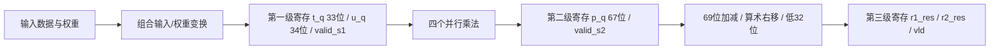

# Winograd F(2,3) 实现与验证

## 1. 实现约定与公式

顶层为 `winograd_1d`，固定接口保持不变。采用 SystemVerilog-2012、单时钟上升沿、低有效异步复位。复位清零所有寄存器并丢弃在途事务；复位释放由环境安排在非上升沿，不额外增加内部同步器。无效输出周期保持上一组数据，有效位继续移动。

映射 `d0..d3 = r1_x..r4_x`，`g0..g2 = r1_w..r3_w`：

```text
t = [d0-d2, d1+d2, d2-d1, d1-d3]
u = [2*g0, g0+g1+g2, g0-g1+g2, 2*g2]
pi = ti * ui, i=0..3
s0 = p0+p1+p2
s1 = p1-p2-p3
y0 = s0 >>> 1; y1 = s1 >>> 1
```

用下式核对等价性：

```text
p1+p2 = 2*d1*g1 + 2*d2*g0 + 2*d2*g2
p1-p2 = 2*d1*g0 + 2*d1*g2 + 2*d2*g1

s0 = 2*(d0-d2)*g0 + (p1+p2)
   = 2*(d0*g0 + d1*g1 + d2*g2)
s1 = (p1-p2) - 2*(d1-d3)*g2
   = 2*(d1*g0 + d2*g1 + d3*g2)
```

所以 s0、s1 均为偶数；最后算术右移不会损失有效信息，再显式截取低 32 位，得到按模 2^32 回绕的卷积结果。整个 RTL 只有四个 `*` 运算，乘以 2 通过常数左移实现。

手算示例：输入 `[-10,20,-30,40]`，权重 `[2,3,-4]`，得到 `t=[20,-10,-50,-20]`，`u=[4,1,-5,-8]`，`p=[80,-10,250,160]`，`s=[320,-420]`，输出 `[160,-210]`。

## 2. 模块端口

所有数据端口均为 signed；时钟、复位和有效位为无符号单比特。

| 模块 | 输入 | 输出 |
|---|---|---|
| input_transform | d0,d1,d2,d3：32 位 | t0,t1,t2,t3：33 位 |
| weight_transform | g0,g1,g2：32 位 | u0,u1,u2,u3：34 位 |
| output_transform | p0,p1,p2,p3：67 位 | y0,y1：32 位 |
| winograd_1d | clk,rstn,en：1 位；r1_x..r4_x、r1_w..r3_w：32 位 | r1_res,r2_res：32 位；vld：1 位 |

三个 transform 均为组合模块，使用连续赋值，不含寄存器。所有子模块均按名称连接；顶层单个 always_ff 块负责流水寄存器和有效位，每个信号只有一个驱动源。

## 3. 位宽核对

| 信号 | signed 位宽 | 理由及实现 |
|---|---|---|
| d、g | 32 | 完整输入范围 [-2^31,2^31-1] |
| t | 33 | 两个 32 位输入的加减；先扩展再运算 |
| u | 34 | 最多三个 32 位权重的加减；先扩展再移位/加减 |
| p | 67 | 33×34 位完整有符号乘积 |
| 扩展 p、s、右移结果 | 69 | 三个 67 位量相加/减的保守宽度 |
| 输出 | 32 | 最后显式取 [31:0]，有意按模 2^32 截断 |

33 位数据加减结果落在 [-2^32,2^32-1] 内；34 位足以容纳三权重和差。对于乘法，将两个操作数分别显式符号扩展到 67 位，确保乘法表达式为 67 位 signed；真实操作数仍来自 33 位和 34 位，数学乘积完全装得下，不损失信息。输出加减前将各乘积扩展至 69 位，右移也在 signed 69 位域完成。

独立参考模型分别用 signed 64 位保存每个 32×32 位乘积，然后先扩展成 69 位再累加三个乘积，避免三乘积之和超出 signed 64 位范围。参考模型使用直接卷积，不复用 Winograd 变换。

## 4. 寄存边界与逐拍时序



假设复位后每个边沿看到的 en 为 `1,1,0,1,0,0`，三组有效输入分别记为 A、B、C。表中状态均是该边沿 NBA 更新完成后的状态。

| 边沿 | en | 第一级有效数据 | 第二级有效数据 | 输出数据 | vld |
|---|---|---|---|---|---|
| E0 | 1 | A | 无 | 保持复位值 | 0 |
| E1 | 1 | B | A | 保持复位值 | 0 |
| E2 | 0 | 无 | B | A | 1 |
| E3 | 1 | C | 无 | B | 1 |
| E4 | 0 | 无 | C | 保持 B | 0 |
| E5 | 0 | 无 | 无 | C | 1 |

第一级有效位取当前 en，第二级取旧 valid_s1，输出有效位取旧 valid_s2。输出数据更新也由旧 valid_s2 控制，不能用刚赋值的 vld 判断。输入 A 在 E0 接受、E2 输出，跨两个完整周期，经过三个寄存边沿；可以每拍接受新组。

数据寄存器在各自上游有效时写入，无效时保持；有效位始终移位。因此 en=0 只产生气泡，不阻止前面的事务前进。异步复位同时清零所有级的数据和 valid，复位前事务不再输出；复位后首个输入仍在其 E0→E2 正常到达。

公开测试的首组数据在 20ns 驱动、25ns 采样，45ns 边沿后输出 `[160,-210]` 且 vld=1，46ns 比较通过。

## 5. 组合路径与物理时序边界

| 路径类型 | 对应结构 | 候选组合逻辑 |
|---|---|---|
| 输入到寄存器 | 输入端口 → 第一级 t_q/u_q | 33 位数据加减；34 位权重加减，u1/u2 表达式含两层加减 |
| 寄存器到寄存器 | 第一级 → 第二级 | 四个并行乘法，输入带有效位选择逻辑 |
| 寄存器到寄存器 | 第二级 → 输出寄存器 | 每个结果两层 69 位加减；常数右移与切片通常可化为布线，另有保持/更新选择逻辑 |
| 寄存器到输出 | 输出寄存器 → 顶层输出端口 | RTL 中没有额外算术逻辑；实际延迟仍含 clk-to-Q、布线与负载 |

第三阶段表达式分别为 `(p0+p1)+p2`、`(p1-p2)-p3`，RTL 运算图深度各为两层加减。综合工具可能重构，不代表映射后一定串联两个完整进位传播加法器。使能可能映射成寄存器 enable 或输入选择器，也影响最终路径。

本次仅完成功能编译与仿真；没有执行综合、面积统计、门级仿真或 STA，也没有目标库、PVT、时钟/IO/负载约束。因此不能宣称已满足 100MHz、已经证明物理时序或确定某一级一定最慢。10ns 为 testbench 功能时钟周期。异步复位的 recovery/removal 同样需要后续物理时序检查。

## 6. 运行方法与实际结果

在工程根目录运行原命令：

```powershell
powershell -NoProfile -ExecutionPolicy Bypass -File .\run-local.ps1 -Task winograd
```

该命令本次失败于文件列表解析，报 `winograd.f:1: ERROR: File name not terminated.`，尚未编译 RTL。检查发现原文件最后一行没有末尾换行；用末尾补换行的独立副本复跑后，公开测试可以通过。按约束没有修改原始 `.f`、testbench 或 `run-local.ps1`。

新增以下入口直接传入源文件参数，绕过原始文件列表的格式问题，同时运行原始公开 testbench 与新增独立自检：

```powershell
powershell -NoProfile -ExecutionPolicy Bypass -File .\run-winograd-checks.ps1
```

该脚本实际执行以下两组 `iverilog -g2012 -Wall -DNO_FSDB` 编译和 `vvp` 仿真，均返回退出码 0；编译日志无告警。原始 FSDB 系统任务由既有 NO_FSDB 开关关闭。

公开测试额外通过独立的 `verification/winograd_wave_dump.sv` 导出 `build/winograd/winograd_public.vcd`，可用 Surfer 或 GTKWave 查看。该仿真辅助模块不会进入 DUT，原 testbench 无需修改。每次运行上述脚本会重新生成波形。

| 检查 | 关键输出 | 实际结果 |
|---|---|---|
| 原始公开 testbench | ALL PASS: Winograd, 10 cases | 10/10 通过 |
| 独立自检 | ALL PASS: Winograd selfcheck accepted=3193 checked=3191 reset_flushed=2 bubbles=363 cycles=3554 | 通过 |

独立自检包含：

- 单独手算例、全零、正负混合和奇数权重和。
- 所有 3^7=2187 种 MIN/ZERO/MAX 输入及权重组合，包括三乘积之和超出 signed 64 位、最终低 32 位回绕。
- 固定种子 xorshift32 产生的 1000 组全位宽随机输入和权重。
- 连续输入、单个气泡、连续气泡；气泡的输入故意驱动 X，检查其不会污染有效输出。
- 逐拍比较 0/1 两种 vld、两组输出及无效期间的数据保持，使用 !== 检测未知值。
- 非时钟边沿异步复位，在途两组被清空，所有流水寄存器清零；复位后首组及时恢复。
- 独立 scoreboard 记录 E0→E2 延迟，不读取 DUT valid 来决定期望输出；下降沿驱动，上升沿后 1ns 检查，避开 NBA 竞争。

接受 3193 组中有 2 组被故意复位丢弃，因而正确输出及核对 3191 组，不将这两组计为算术通过样本。测试结束检查接受、输出、复位丢弃数量守恒。

日志保存在工程根目录下：

```text
build/winograd/public.compile.log
build/winograd/public.simulation.log
build/winograd/selfcheck.compile.log
build/winograd/selfcheck.simulation.log
```

## 7. 文件与范围

完整 RTL：`src/input_transform.v`、`src/weight_transform.v`、`src/output_transform.v`、`src/winograd_1d.v`。

新增验证：`verification/winograd_1d_selfcheck_tb.sv`，以及根目录 `run-winograd-checks.ps1`。原始公开 testbench、文件列表、本地运行脚本和 CORDIC/FSM 文件均保留，使用 SHA256 与实现期间保存的基线比对验证未改。
